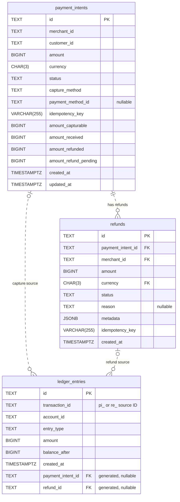

# Payments API contract

The contract defines six PaymentIntent operations and three Refund operations for issue #2.
The URL prefix is `/v1`. The path keys do not include this prefix.

## Files

- `payment_intents.yaml` defines the PaymentIntent operations.
- `refunds.yaml` defines the Refund operations.
- `schemas.yaml` defines the request and response models.

The contract references the shared headers, pagination parameters, and ProblemDocument.
The x-responses section in payment_intents.yaml defines the named error responses.
Both path files reference those responses.
The `x-retrieve`, `x-confirm`, `x-capture`, and `x-cancel` fields store reusable path items.
Their references make the operations available at the paths listed below.

## Integration

Keep the existing `/payment-intents` reference in the project root specification.
The owner of that specification must add these entries under `paths`:

```yaml
/payment-intents/{id}:
  $ref: "./payments/payment_intents.yaml#/x-retrieve"
/payment-intents/{id}/confirm:
  $ref: "./payments/payment_intents.yaml#/x-confirm"
/payment-intents/{id}/capture:
  $ref: "./payments/payment_intents.yaml#/x-capture"
/payment-intents/{id}/cancel:
  $ref: "./payments/payment_intents.yaml#/x-cancel"
/refunds:
  $ref: "./payments/refunds.yaml"
/refunds/{id}:
  $ref: "./payments/refunds.yaml#/x-retrieve"
```

The root specification and gateway currently use `/api/v1`.
During integration, align both with the required `/v1` prefix.
Then generate the API code and update the strict handlers.
The new contract replaces the old stub-only 501 response.

## Contract rules

- Creation requires an Idempotency-Key with 1 to 255 characters.
- An identical creation retry returns the original status and response body.
- Automatic confirmation captures the full amount.
- Manual confirmation requires a separate full capture.
- Cancellation is permitted before capture.
- A refund requires a captured payment.
- Pending and successful refunds cannot exceed the captured amount.
- Cursor IDs must match the collection and active filters.
- The default limit is 10. The maximum limit is 100.
- Each operation describes the required permission scope.
- Valid credentials without that permission receive 403.
- List filters with no matches return an empty list.

The YAML descriptions contain the full state rules and examples.
The root specification, generated server, and runtime handlers are outside this change.

## PostgreSQL schema

`database/migrations/002_payments.sql` creates the three Payments tables.
The path matches the PostgreSQL initialization mount in the infrastructure pull request.
Apply this migration once with the database migration owner:

```sh
psql -v ON_ERROR_STOP=1 -d "$DATABASE_URL" -f database/migrations/002_payments.sql
```

### Entity relationship diagram

This diagram shows the tables and foreign keys in the migration.
Each table has its own primary key.



- Each refund belongs to exactly one PaymentIntent.
- The refund uses one composite foreign key: `(payment_intent_id, merchant_id, currency)`.
  It references `(id, merchant_id, currency)` in `payment_intents`.
- Each ledger entry references exactly one source: a PaymentIntent or a Refund.
  The two optional source relationships are mutually exclusive.
- The database generates both ledger foreign-key columns from `transaction_id`.
  A `pi_` ID sets `payment_intent_id`. A `re_` ID sets `refund_id`.
  The application does not supply these generated columns.
- `merchant_id` and `customer_id` have no foreign keys to Identity yet.
  `account_id` has no foreign key because this migration does not define an accounts table.

| Table | Additional unique keys |
| --- | --- |
| `payment_intents` | `(merchant_id, idempotency_key)` and `(id, merchant_id, currency)` |
| `refunds` | `(merchant_id, idempotency_key)` |
| `ledger_entries` | `(transaction_id, account_id, entry_type)` |

The migration creates a NOLOGIN permission group named `stripe_lite_payments_app`.
Grant that group to the application login during deployment.
The application login must not own the tables or have superuser privileges.
Ledger rows permit SELECT and INSERT only. Triggers also reject UPDATE, DELETE, and TRUNCATE.
A capture or successful refund must post balanced ledger entries in the same database transaction.
Each side must equal the source amount. A posting must use at least two accounts.
The balance checks run at commit. A single-sided posting cannot commit.

Refund creation reserves its amount under a lock on the parent payment.
A successful refund moves the reservation into the refunded total.
A failed refund releases its reservation. Applications cannot update these totals directly.
Refunds derive merchant and currency from their parent payment.
Idempotency keys are unique per merchant and creation operation.
Request hashes and original response replay remain part of the service implementation.

Merchant and customer IDs use TEXT until the Identity schema is available.
Cross-domain foreign keys need agreement on the Identity ID types.
The migration does not create placeholder Identity tables.
The account ID identifies an external ledger account.
The service must validate account ownership and currency and calculate balance_after under an account lock.
This migration does not define account records or processor integration.
